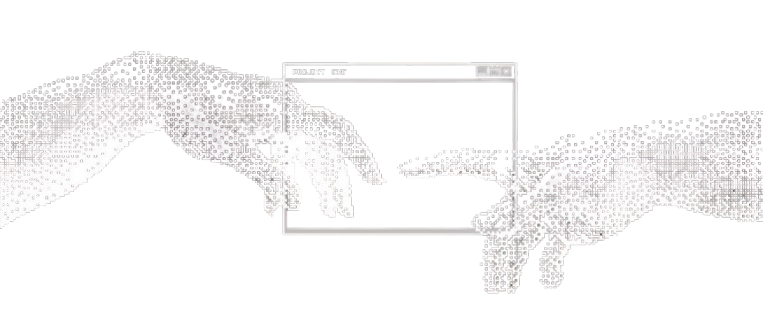

## 🫆 Sobre mí

Soy **Técnico en Sistemas Microinformáticos y Redes** y estudio **2º de Desarrollo de Aplicaciones Web (DAW)**.
Tengo casi 2 años de experiencia en **soporte IT y helpdesk**: incidencias de hardware y software, atención a usuarios y gestión de plataformas como Moodle y CRM.

Me gusta entender cómo funciona todo, desde el equipo hasta la web, y personalizar y automatizar lo que uso cada día.

- 🔭 Ahora mismo: aprendiendo JavaScript y desarrollo en entorno cliente
- 💼 Busco: **Soporte IT / Helpdesk** en el Vallès Oriental (Barcelona)
- 🌍 Idiomas: catalán y castellano (nativo), inglés (B1-B2)

## 🧑‍💻 Tecnologías

**Desarrollo**

**Sistemas**

## 🚀 Proyectos

| Proyecto | Descripción | Tecnologías |
|---|---|---|
| [**bot_telegram**](https://github.com/CristianMainVS/bot_telegram) | Bot personal para gestionar tareas con prioridad, notas por categoría y recordatorios automáticos. Datos separados por usuario y persistencia en SQLite. | Python · SQLite |
| [**cliente-ejercicios**](https://github.com/CristianMainVS/cliente-ejercicios) | Prácticas de Desarrollo Web en Entorno Cliente (DAW): DOM, eventos y formularios. | HTML · CSS · JavaScript |
